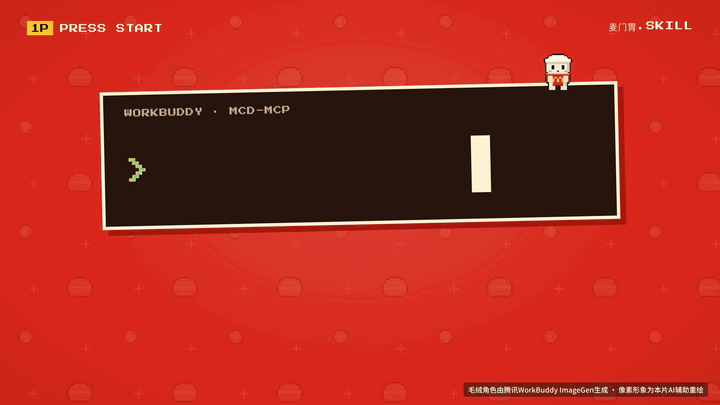
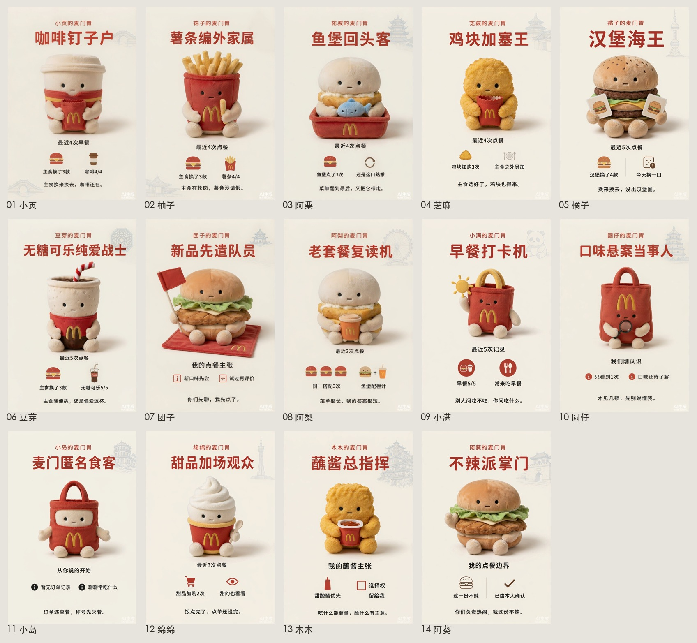
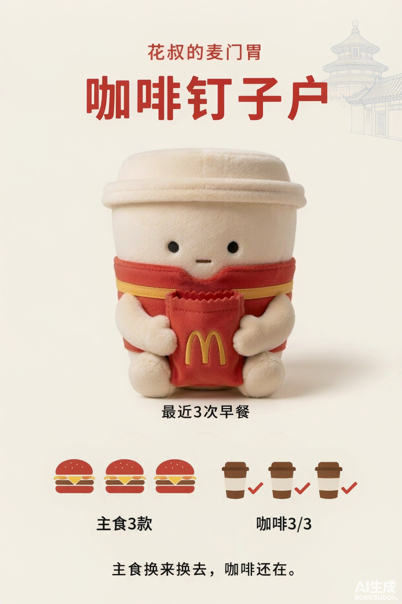
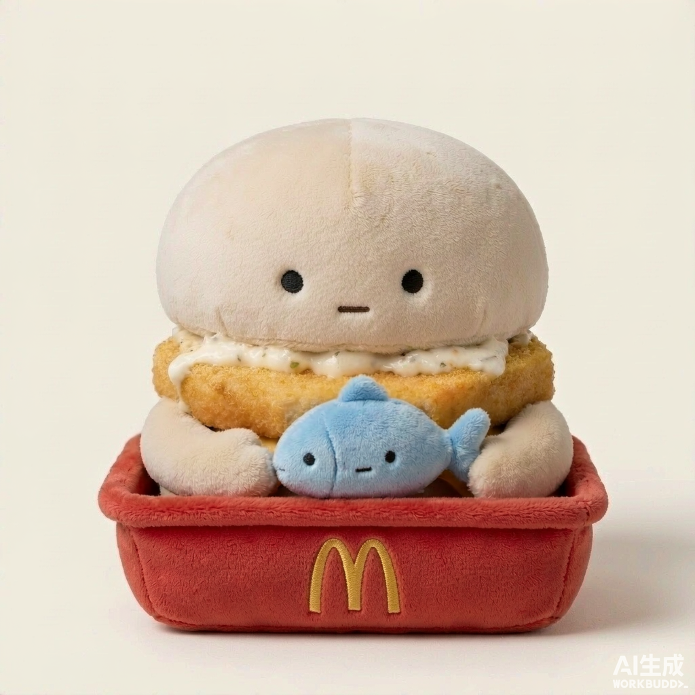
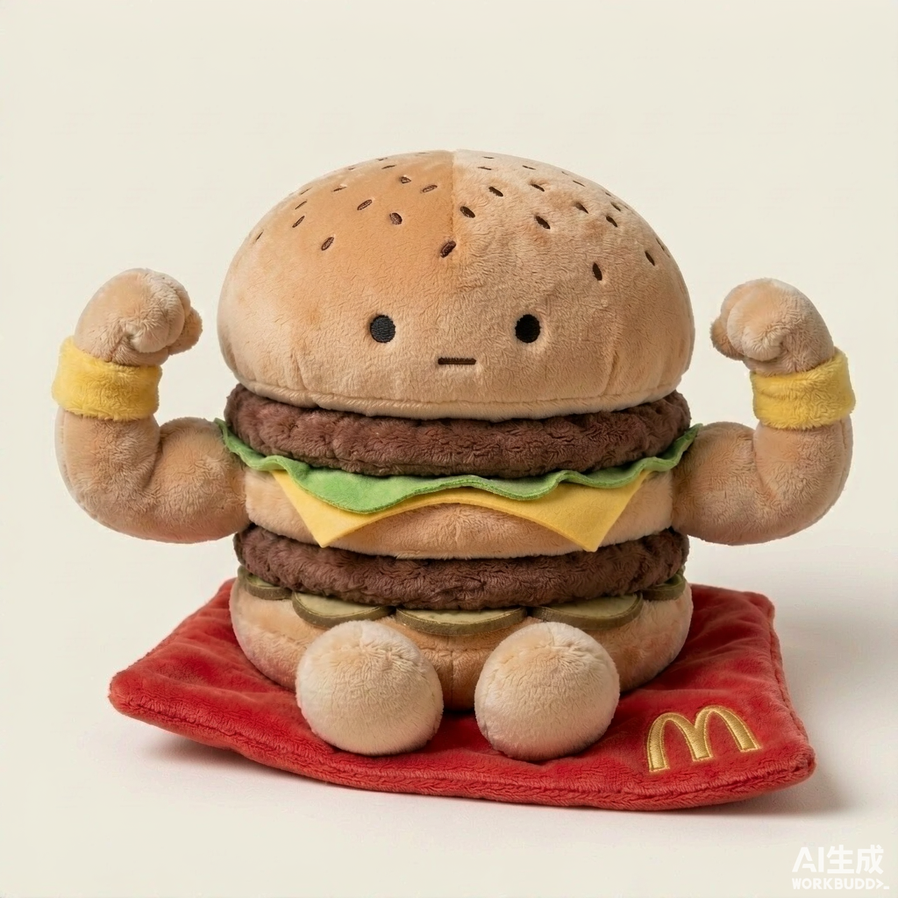

# 麦门胃 · 胃.skill（mcstomach）

> 把你的麦当劳订单，蒸馏成一个能带走的「胃」。

<p align="center">
  
</p>
<p align="center"><sub>30 秒发布动画，角色由腾讯WorkBuddy ImageGen 生成。带声音的完整版在<a href="#有声版发布动画">文末</a>。</sub></p>

<p align="center">
  
</p>
<p align="center"><sub>14 种胃称号卡，由腾讯WorkBuddy ImageGen 生成（每张卡右下角保留「AI生成」标识）。卡上的昵称、城市和统计都是虚构示例，不是任何真实用户的数据。</sub></p>

对你的 AI 说一句「**蒸馏我的胃**」，它会通过麦当劳官方 MCP 只读你最近的订单，带着证据告诉你：你的胃到底在坚持什么。你点头确认后，它给你一份可以随身带走的「个人胃」，还有一张能发出去的胃卡。

以后饿了，把这个胃交给任何一个 AI，它就知道该给你点什么。

## 它能做什么

| 你说 | 它做 |
|---|---|
| 「蒸馏我的胃」 | 只读你最近的订单 → 带计数和置信度提炼口味规则 → 只追问真有歧义的地方 → 你确认后生成个人胃和分享卡 |
| 「饿了」 | 先过滤你的硬忌口，再按「熟悉 / 小变化 / 尝新」三档给候选；凑不够三档就如实少给 |
| 「我们的胃合不合」 | 只在两个人都已知的维度上比，说清哪里合、哪里得有人迁就，再给一个两人都能吃的折中 |
| 「吃完了，今天没那么想吃薯条」 | 增量更新规则，保留原来的依据，不会一顿饭抹掉全部偏好 |

几条它守住的规矩：

- **每条结论都能指回订单。** 指不回去的标「待确认」，或者干脆不说。
- **只读不写。** 不下单、不领券、不兑换、不抽奖、不建地址。
- **不评价人。** 笑点只落在「可爱的饮食坚持」上，不推断职业、收入、身材、健康和感情。
- **没点过不等于不喜欢。** 硬忌口只来自你亲口说的。

## 胃卡长什么样

<p align="center">
  
  &nbsp;
  
  &nbsp;
  
</p>

左边是作者本人的胃：最近 3 次早餐，主食换了 3 款，咖啡 3/3 都在，于是得了「咖啡钉子户」。右边两只是角色库里的毛绒角色。

- 每个胃第一次生成时抽一次外观：80% 是毛绒常规款，20% 开出复古像素隐藏款。抽中就跟着这个胃走，改昵称、重新出卡都不重抽。
- 卡片由宿主的生图能力整张生成，少字、图形化，只写白名单里的信息（称号、一句宣言、几个聚合计数），不写地址、订单号、门店、价格和时间。
- 本仓库的角色图和卡片都由腾讯WorkBuddy 的 ImageGen 生成，保留了平台的「AI生成」角标和图片内的 AI 生成隐式标识。例外两类：`mcstomach/assets/brand/` 是麦当劳官方图，`mcstomach/assets/style/reference-J/` 是作者另一个项目的吉祥物参考图。

## 适合谁用

- **麦门常客**：想看看自己最近到底在吃什么、在坚持什么。
- **总被问「吃什么」的人**：把「可分享/我的胃.md」发给对象、室友、同事，让对方的 AI 帮你挑。
- **一起点餐的两个人**：看看谁该迁就谁。
- **还没有麦当劳 MCP Token 的人**：走最多 5 道题的问卷，也能做出一份自述版的胃（会标明来源是自述，不是订单）。
- **想做 MCP 个性化应用的开发者**：可以参考它怎么在只读数据上做到「有证据、可复算、分享不漏隐私」。

## 两种入口

1. **装 skill ＋ 授权麦当劳官方 MCP**：装好后对 AI 说「蒸馏我的胃」。这是主路径，下面「安装」一节就讲这个。还没有 Token 时，同一个 skill 会自动改走最多 5 道题的问卷。
2. **小程序问答版**：不用配置，回答几道题就能出胃卡。**即将上线**，上线后会把入口放在这里。

## 安装

需要：一个支持 skill 的 AI 智能体（开发和实测用的是腾讯WorkBuddy），以及 Python 3.9 或更新版本（脚本只用标准库，不用装依赖）。

### 第一步：申请麦当劳 MCP Token

打开 [open.mcd.cn/mcp](https://open.mcd.cn/mcp)，用手机号登录 → 右上角「控制台」→「激活」→ 同意服务协议 → 复制 Token。详细图文见[麦当劳 MCP Server 使用指南](https://github.com/M-China/mcd-mcp-server)。

没有 Token 也可以先跳过，skill 会走问卷入口。

### 第二步：把麦当劳 MCP 配进你的智能体

以腾讯WorkBuddy 为例：左侧栏「专家 · 技能 · 连接器」→「连接器」→ 右上角「自定义连接器」→「配置MCP」，填入 [`mcp-config.example.json`](mcp-config.example.json) 的内容，把 `${MCD_MCP_TOKEN}` 换成你自己的 Token，保存后把 `mcd-mcp` 启用。

```json
{
  "mcpServers": {
    "mcd-mcp": {
      "type": "streamablehttp",
      "url": "https://mcp.mcd.cn",
      "headers": { "Authorization": "Bearer ${MCD_MCP_TOKEN}" }
    }
  }
}
```

Token 只填在你自己的客户端里，不要提交进任何仓库。本 skill 不读取、不保存、不转发 Token。

### 第三步：安装 skill

先把仓库拿到本地：

```bash
git clone https://github.com/alchaincyf/mcstomach.git
cd mcstomach
```

注意：clone 下来的最外层文件夹也叫 `mcstomach`，那是整个仓库。**真正的 skill 是它里面那个含 `SKILL.md` 的 `mcstomach/` 子文件夹**，下面上传或复制的都是它。

然后二选一：

- **腾讯WorkBuddy**：「专家 · 技能 · 连接器」→「技能」→「添加技能」→「上传技能」，选择里层的 `mcstomach/` 文件夹。要传整个文件夹，单传 `SKILL.md` 不够，它依赖旁边的 `scripts/` 和 `references/`。优先直接传文件夹；一定要用 zip 的话，macOS 自带的压缩不给中文文件名打 UTF-8 标记，可能解压成乱码，打包后先自己解压一遍确认文件名正常。
- **用技能目录的智能体**：把里层的 `mcstomach` 整个复制进技能目录。命令里 `mcstomach` 后面**不要加斜杠**——macOS 上 `cp -R mcstomach/` 会把里面的文件摊平倒进技能目录。

  ```bash
  # 在仓库根目录执行。用户级（所有项目可用）；其他智能体换成它自己的技能目录
  mkdir -p ~/.workbuddy/skills && cp -R mcstomach ~/.workbuddy/skills/
  # 或项目级（跟着某个项目走）
  mkdir -p <你的项目>/.agents/skills && cp -R mcstomach <你的项目>/.agents/skills/
  # 装完确认一下
  ls ~/.workbuddy/skills/mcstomach/SKILL.md
  ```

### 第四步：检查一下

在仓库根目录跑：

```bash
python3 mcstomach/scripts/mcstomach.py --help
python3 mcstomach/tests/test_mcstomach.py   # 164 项
python3 mcstomach/tests/test_persona.py     # 52 项
python3 mcstomach/tests/test_visual.py      # 16 项
```

测试全部用虚构夹具，不需要 Token，也不联网。

## 使用示例

装好之后，在对话里直接说：

```text
你：蒸馏我的胃
AI：读到你最近 N 笔麦当劳订单（其中 M 笔已取消，不算）。……（揭晓、追问、等你确认）
你：对，就是这样
AI：（生成个人胃和分享卡）

你：饿了
AI：（先过滤硬忌口，再给「熟悉 / 小变化 / 尝新」三档候选；价格、热量没有实时数据就标「待查」）

你：（把朋友发来的「我的胃.md」贴进来）我们的胃合不合
AI：（只比两人都已知的维度，再给一个折中）
```

### 不经过对话，直接跑一遍确定性流程

skill 在对话里也是调用这几条命令。下面用仓库自带的**虚构**订单走一遍（macOS / Linux 的 shell；Windows 请用 WSL 或 Git Bash）：

```bash
S=mcstomach/scripts/mcstomach.py
F=mcstomach/tests/fixtures
OUT=$(mktemp -d)
python3 $S normalize --raw $F/orders_fish_coffee_fictional.json --out $OUT/norm.json \
        --as-of 2026-09-28T12:00:00+08:00 --fetch-state ok
python3 $S distill --orders $OUT/norm.json --answers $F/answers_fish_coffee_fictional.json \
        --points $F/points_known_fictional.json --out $OUT/profile.json
python3 $S validate --profile $OUT/profile.json
python3 $S assign-visual --profile $OUT/profile.json --out $OUT/profile.json
python3 $S export --profile $OUT/profile.json --out $OUT/我的胃
```

关键输出（节选，真实运行结果）：

```text
[normalize] 原始 4 笔 → 有效 4 笔，剔除取消 0 笔，疑似代点 0 笔，可归于本人 4 笔；样本档位 type_ready；来源状态 normal
[distill] 规则 2 条，待确认问题 0 条，样本档位 type_ready，身份 菜单钉子户
[validate] 通过：0 个错误，0 个警告
[assign-visual] 首次分配完成：plush（毛绒常规款）
```

`assign-visual` 是随机抽签，大约每 5 次有 1 次会显示 `retro_pixel（复古像素隐藏款）`；抽中后写进画像，之后不再重抽。`export` 还会逐行列出导出的 6 个文件。

导出的证书文案（`CERTIFICATE.txt`）：

```text
【麦门胃 · 菜单钉子户】

本胃已把【麦香鱼】设成默认选项。

依据：4 笔可归于本人的订单里【麦香鱼】出现 4 次
来源：最近 4 笔订单
段位：长老（娱乐段位，非麦当劳官方评级；阈值公开可复算，只看累计积分，不看订单数。）

把这个胃文件交给你的 AI，跟它说「用这个胃帮我挑一餐」。
把你的胃发来，看今晚谁迁就谁。

—— 昵称与类型为娱乐性解读，不是人格诊断。
```

导出目录里有这些：

| 文件 | 能不能发给别人 |
|---|---|
| `可分享/我的胃.md` | 可以。只带硬忌口、偏好和点餐规则，不含身份、订单、时间、金额、积分、地点 |
| `share-card.json`、`CERTIFICATE.txt` | 可以。白名单字段 |
| `SKILL.md`（个人胃） | 只交给你信任的 AI |
| `profile.json`、`报告.md` | 不要发，私密 |

更多参数和细则见 [`mcstomach/README.md`](mcstomach/README.md)。

## 诚实边界

- 麦当劳 MCP 的 `order-list` 只返回**最近最多 10 笔**订单，所以它说的是「最近 N 笔」，从不说「你一共点过 N 次」。
- 订单只能证明「点了什么」，证明不了「为什么点」。
- 段位是本项目自定义的娱乐评级，不是麦当劳官方等级；累计积分不等于消费金额，也不等于点单次数。
- 价格、热量、门店有没有货，没有实时数据就标「待查」，不编「到手价」。
- 生图卡依赖宿主智能体的生图能力；没有生图能力时如实降级，不谎称已生成。

## 仓库里有什么

```text
README.md                  本文件
CONTEST_DECLARATION.md     参赛声明（官方原文，未改动）
MCP_INTEGRATION.md         用到的麦当劳 MCP 工具、调用流程、数据流与业务价值
mcp-config.example.json    MCP 配置示例（只有环境变量占位符）
workbuddy.md               腾讯WorkBuddy 开发对话（公开脱敏版）
docs/images/               README 用图
mcstomach/                 skill 本体：直接放进技能目录就能用
├── SKILL.md               入口
├── references/            按需读取的细则（揭晓话术、归一口径、隐私白名单、生图指南……）
├── scripts/               确定性脚本：归一、计数、校验、导出、个性化
├── assets/                角色与风格参考图、分享卡模板
└── tests/                 232 项测试与 30 个虚构夹具
```

skill 文档里偶尔提到的 `配图/`、`设计/`、`开发记录/` 等路径，是作者开发项目里的过程目录（候选图、对照页、需求单），没有随仓库公开，不影响使用。

## 怎么做出来的

skill 的代码、测试和角色生图在腾讯WorkBuddy 里完成，过程见 [`workbuddy.md`](workbuddy.md)（2026-09-28 至 09-29 的主开发会话）。需求单和独立验收由作者在会话外准备，再交给 WorkBuddy 执行；真实订单的读取与盲测也在会话外完成，见 [`MCP_INTEGRATION.md`](MCP_INTEGRATION.md)。首页那 14 张称号卡是之后另一轮 WorkBuddy 生图做的，不在这份导出里。方法上用了 [女娲 · Skill造人术](https://github.com/alchaincyf/nuwa-skill) 的思路——先看一手数据，再提炼决策偏好，遇到矛盾就追问，最后落成可运行的规则。

麦当劳 MCP 的具体接入方式见 [`MCP_INTEGRATION.md`](MCP_INTEGRATION.md)。

## 声明与许可

- 本项目是麦当劳程序员节创意开发大赛的参赛作品，由参赛者独立开发，**不是麦当劳官方产品**。参赛声明见 [`CONTEST_DECLARATION.md`](CONTEST_DECLARATION.md)。
- 项目输出仅供娱乐和参考，不构成营养或其他专业建议；餐品、价格和供应以麦当劳官方渠道的实时结果为准。
- 代码与文档以 [MIT License](LICENSE) 开源。`mcstomach/assets/brand/` 里的麦当劳标志与餐品图来自麦当劳官方公开图片地址（可乐图上带可口可乐商标），权利归各自权利人，不在 MIT 授权范围内，只作造型参考；MIT 也不授予任何商标权。

作者：花叔（[@alchaincyf](https://github.com/alchaincyf)）。觉得好玩的话，欢迎点个 Star。

## 有声版发布动画

https://github.com/user-attachments/assets/bed3ecfe-386a-440c-aa4b-6f6d761fd0c9
